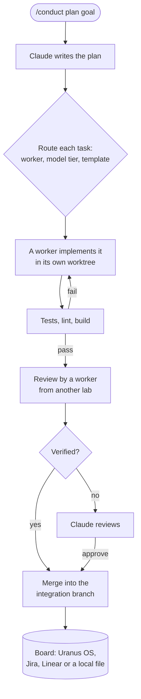

<p align="center">
  <picture>
    <source media="(prefers-color-scheme: dark)" srcset="assets/brand/uranus-logo-dark.svg">
    
  </picture>
</p>

<h1 align="center">Conductor</h1>

<p align="center">
  A Claude Code plugin that splits a goal into tasks and runs them in parallel<br>
  across Claude, Codex, OpenCode, Cursor and Antigravity, each in its own git worktree.
</p>

<p align="center">
  <a href="https://github.com/uranus-workspace/conductor/actions/workflows/ci.yml"></a>
  <a href="https://github.com/uranus-workspace/conductor/releases/latest"></a>
  <a href="LICENSE"></a>
</p>

<p align="center">
  <a href="#install">Install</a> ·
  <a href="#usage">Usage</a> ·
  <a href="docs/architecture.md">Architecture</a> ·
  <a href="#configuration">Configuration</a> ·
  <a href="#development">Development</a>
</p>

---

## How it works

You give Claude a goal with `/conduct plan`. Claude writes a plan: tasks, acceptance criteria, the files each task touches, and the dependencies between them. From there the Conductor runs the tasks on its own:



- **Routing.** Jev, a classification model, picks the worker, the model tier and the workflow for each task. Rules decide when Jev is not configured, and risky paths (`auth/`, `billing/`, migrations, tax code) always get the strictest workflow.
- **Workflows.** Each task follows a template: `solo`, `feature`, `bugfix`, `refactor` (one worker per module in parallel), `secure` (security scan and human approval) or `spike` (research only, nothing merged). Retries, budgets and time limits are part of the template, and each step is recorded. `/conduct graph <task>` shows the path a task took.
- **Review.** A change is never reviewed by the worker that wrote it. The reviewer comes from another lab when one is available.
- **State.** Runs and tasks are stored on a board, not in the conversation, so a run continues after `/clear`, a crash or a restart.
- **Models.** Model calls go through OpenRouter by default, including Jev. Cursor and Antigravity use their own logins.

The full design is in [docs/architecture.md](docs/architecture.md).

## Install

In Claude Code:

```
/plugin marketplace add uranus-workspace/conductor
/plugin install conductor@uranus
```

You also need `git` and at least one worker CLI signed in: `claude`, `codex` (`codex login`), `opencode`, `cursor-agent` (`cursor-agent login`) or `agy`.

**Updates.** Third-party plugins don't update on their own until you turn it on: `/plugin` → **Marketplaces** → `uranus` → **Enable auto-update**. To update by hand, run `claude plugin update conductor@uranus`, then `/reload-plugins`.

**Uninstall.** Run `/conduct stop` in any project with a run and `/conduct key remove`, then `claude plugin uninstall conductor@uranus`.

[docs/install.md](docs/install.md) has the details: a team setup with auto-update in `settings.json`, and the files and branches the Conductor leaves in your projects.

## Usage

```
/conduct key                 store your OpenRouter key in the system keychain
/conduct workers             see which workers are switched on and ready
/conduct plan <goal>         start a run
```

While a run is active, a band above the prompt shows its progress, and a dashboard opens beside the chat:

```
▶ r1  ███████▓▓░░░  8/12  ● 2 running  ◆ 1 review  1.2M tok  US$ 4.10 / 50.00
   ● t3 codex/standard · implement · 3m 12s   ● t7 claude/strong · review · 41s
```

The dashboard has the progress bar, tiles for running, review, failed, tokens, run cost and today's spend against their budgets, the cost of each worker, and every task with the step it is at, its tokens and its cost, with Approve, Retry and Graph buttons. The desktop app draws its charts as SVG; the terminal draws them as text.

Claude is only interrupted when a task needs a decision: a review, a merge conflict, a stuck run or a finished run.

| Command | Description |
|---|---|
| `/conduct plan <goal>` | Start a run; Claude writes the plan |
| `/conduct status` | List tasks and open the dashboard |
| `/conduct graph <task>` | Show a task's workflow and the path it took |
| `/conduct run`, `pause`, `stop` | Resume, stop dispatching, or stop everything |
| `/conduct retry <task> [worker]` | Retry a task, optionally on another worker |
| `/conduct cost` | Cost by worker, by step and by client, and today's total; opens the dashboard |
| `/conduct workers`, `worker <id> on\|off`, `on`, `off` | Switch the Conductor or single workers on and off |
| `/conduct key [status\|remove]` | Manage the OpenRouter key |
| `/conduct source` | Check the connection to the configured board |
| `/conduct figma <link>` | Fetch the design context of a Figma link |
| `/conduct jev` | Compare Jev's decisions with the rules and suggest thresholds |
| `/conduct stats [days]` | Sessions, worktrees, cost, tokens, success by worker, model and template, top errors |
| `/conduct handoff` | Write a short summary of the conversation for after a `/clear` |

## Workers

| Worker | Command | Models | Typical use |
|---|---|---|---|
| `claude` | `claude -p` | OpenRouter or own login | Tasks that need judgment |
| `codex` | `codex exec` | OpenRouter or own login | Well-specified logic; default reviewer |
| `opencode` | `opencode run` | OpenRouter | Simple, low-risk tasks |
| `cursor` | `cursor-agent -p` | own login | Mechanical edits across many files |
| `antigravity` | `agy -p` | own login | Well-specified feature work |
| `openrouter` | HTTP | OpenRouter | Text files only (docs, fixtures) |

Workers run in worktrees under `~/.conductor/worktrees/`, outside your project. They never push. Merging the integration branch into your branch is up to you.

## Boards

| Board | Run | Task | Connection |
|---|---|---|---|
| `local` | entry in `.conductor/tasks.json` | entry in the same file | none |
| `uranus` | epic | task in the epic | Uranus OS MCP server |
| `jira` | epic | issue in the epic | Atlassian MCP server |
| `linear` | project | issue in the project | Linear MCP server |

The Conductor finds the MCP server in your session by its tools, so the connector's name does not matter. It writes status changes, dependencies and comments to the board, and picks up tasks cancelled there. Tasks can include Figma links; the design context goes into the worker's instructions.

## Configuration

Put overrides in `.conductor/config.json` in your project. Every field is optional.

```json
{
  "gateway": "openrouter",
  "checks": ["npm test"],
  "setup": ["npm ci"],
  "maxRetries": 2,
  "concurrency": { "claude": 2, "codex": 2, "opencode": 3, "total": 4 },
  "budgets": { "taskUsd": 5, "runUsd": 50, "dayUsd": 100 },
  "decision": { "mode": "shadow" },
  "taskSource": { "kind": "jira", "jira": { "projectKey": "CP", "site": "acme.atlassian.net" } },
  "figma": { "clientFrameworks": "react" }
}
```

- `gateway`: `openrouter` or `native` (each CLI's own login). A worker's `provider` overrides it.
- `decision.mode`: `rules`, `shadow` (Jev's answers are logged, the rules decide) or `enforce` (Jev decides when confident, the rules otherwise).
- Models are set per worker and provider in `executors.<id>.models`. All defaults are in [src/core/config.ts](src/core/config.ts).
- `metrics`: the ledger behind `/conduct stats`, on by default, in `~/.conductor/metrics` (see [docs/metrics.md](docs/metrics.md)).

The OpenRouter key is read from `OPENROUTER_API_KEY`, or from the system's secret store after `/conduct key`: the Keychain on macOS, the Secret Service (GNOME Keyring, KWallet or KeePassXC) on Linux. See [docs/install.md](docs/install.md#the-openrouter-key).

## Security

- Each worker runs in a separate worktree without your `.env` files, and cannot push or deploy.
- API keys and Brazilian CPF/CNPJ numbers are masked before text is sent to OpenRouter or a board. An optional setting does the same for the conversation itself.
- Claude cannot edit files in a worktree while a worker is using it.
- Spending stops at the per-task, per-run and per-day budgets.

## Development

```bash
npm ci
npm test                         # unit and end-to-end tests (real git, simulated CLIs and MCP servers)
npm run typecheck
npm run validate                 # claude plugin validate
npm run test:mod                 # tests of the plugin inside Claude Code
npm run smoke                    # live run with the installed worker CLIs (uses real tokens)
node tests/live/openrouter.ts    # live check of Jev and OpenRouter
```

Logs and the metrics ledger are described in [docs/metrics.md](docs/metrics.md). Code conventions are in [CLAUDE.md](CLAUDE.md). The original design notes are in [docs/CONTEXT.md](docs/CONTEXT.md), and findings about the APIs used are in [docs/api-findings.md](docs/api-findings.md).

## Contributing

Issues and pull requests are welcome. Read [CONTRIBUTING.md](CONTRIBUTING.md) first; commits follow Conventional Commits, and releases are made from them by semantic-release ([CHANGELOG.md](CHANGELOG.md)). Report security problems privately, as described in [SECURITY.md](SECURITY.md). Everyone taking part follows the [code of conduct](CODE_OF_CONDUCT.md).

## License

[MIT](LICENSE) © Uranus

## Status

Tested against the live services: all five workers, the `feature` workflow with cross-lab review, OpenRouter for Claude, Codex, OpenCode and Jev, and the Uranus OS board. Jira, Linear and Figma are tested against simulated servers only.

---

<p align="center">
  <sub>Made by <a href="https://uranus.com.br">Uranus</a></sub>
</p>
