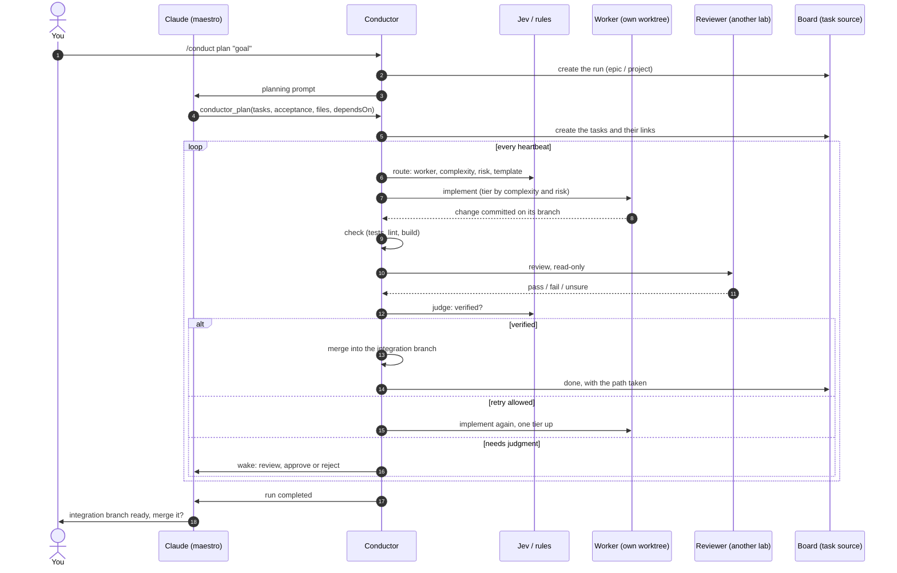
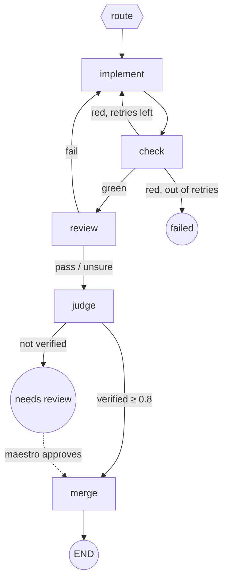

# Architecture

How the Conductor is built, and how a goal becomes merged code.

## The pieces

```mermaid
flowchart TB
  user([You]) -->|/conduct plan goal| session

  subgraph session["Claude Code session"]
    maestro["Claude<br/>plans, reviews, integrates"]
    subgraph mod["Conductor mod (hooks/register.tsx)"]
      cmds["/conduct commands"]
      tools["conductor_* tools<br/>ask_openrouter"]
      ui["band · board pane · graph pane"]
      guard["edit guard · LGPD redaction"]
      beat(["heartbeat<br/>$.clock.every"])
    end
  end

  subgraph core["Core (src/core, src/graph)"]
    conductor["Conductor<br/>route · dispatch · merge queue · budgets · reconcile"]
    graph["Graph engine<br/>templates · edges · limits · ownership"]
    ledger["Ledger<br/>cost per attempt, node, client"]
  end

  subgraph decide["Decisions"]
    rules["RuleDecisionModel"]
    jev["Jev (System One)"]
    router["DecisionRouter<br/>rules · shadow · enforce"]
  end

  subgraph workers["Workers: detached, one git worktree each"]
    claude["claude -p"]
    codex["codex exec"]
    opencode["opencode run"]
    cursor["cursor-agent"]
    agy["agy (Antigravity)"]
    orw["OpenRouter (text)"]
  end

  subgraph sources["Task sources"]
    local[".conductor/tasks.json"]
    uranus["Uranus OS"]
    jira["Jira"]
    linear["Linear"]
  end

  figma["Figma<br/>design references"]
  openrouter{{"OpenRouter<br/>the gateway"}}

  maestro <-->|tools / wake-ups| mod
  beat --> conductor
  cmds --> conductor
  tools --> conductor
  conductor --> graph
  conductor --> ledger
  conductor --> router
  router --> rules
  router --> jev
  conductor -->|scripts/job.sh| workers
  conductor <-->|$.mcp.call| uranus
  conductor <-->|$.mcp.call| jira
  conductor <-->|$.mcp.call| linear
  conductor --> local
  conductor -->|$.mcp.call| figma
  jev --> openrouter
  claude -.-> openrouter
  codex -.-> openrouter
  opencode -.-> openrouter
  orw --> openrouter
  tools --> openrouter
```

- The mod (`hooks/register.tsx`) is the only code that touches Claude Code's `$` API. Everything else (`src/`) talks to the outside through one port, `Host`, so it runs the same under the mod engine and under Node in the tests.
- The task source holds the state. A remote board (Uranus OS, Jira, Linear) is written first; the local file keeps what only this machine needs (processes, worktrees, attempts). A run survives `/clear`, compaction, mod reloads and restarts.
- Workers run detached (`scripts/job.sh`): a hot reload of the mod or a restart of the session does not kill them. The heartbeat reads their `pid`, `exit` and logs from disk.
- Model calls go through OpenRouter for Jev, `ask_openrouter` and every worker whose CLI can route through it. Cursor and Antigravity use their own logins. The key lives in the macOS Keychain (`/conduct key`).

## A run, end to end



## A task's graph

Every task follows a template: nodes and the edges between them, declared in code (`src/graph/templates/`). The route node picks the template; risk ≥ 4 always means `secure`.



That is `feature`. The others:

| Template | Path | When |
|---|---|---|
| `solo` | implement → check → merge | Small, low risk. The default (with checks configured). |
| `feature` | implement → check → review → judge → merge | New functionality with clear criteria. |
| `bugfix` | research → implement → check → review → merge | A bug with a known symptom: reproduce first. |
| `refactor` | implement ×N (one per module) → fan-in → check → review → merge | The same mechanical change across many files. |
| `secure` | implement → check → security → review → human → merge | Auth, payments, tax rules, migrations. |
| `spike` | research → report | An investigation; nothing is merged. |

Rules the engine enforces:

- Stopping rules (retries, budget, time) are on the edges, never inside a node. A retry goes back only to the node that produced the failure and climbs one model tier.
- Each state field has one owner node. A node that writes another node's field fails.
- The reviewer is never the worker that wrote the change, and comes from another lab when one is available.
- Every edge taken is recorded with its reason. `/conduct graph <taskId>` draws the template and the path taken, and a finished task gets that drawing as a comment on its board.
- A task's status is derived from its position in the template, never set by hand.
